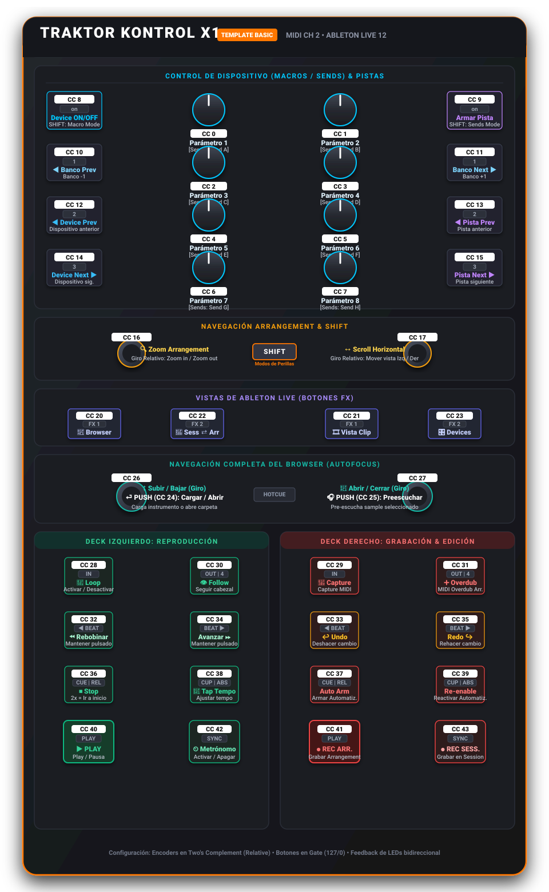
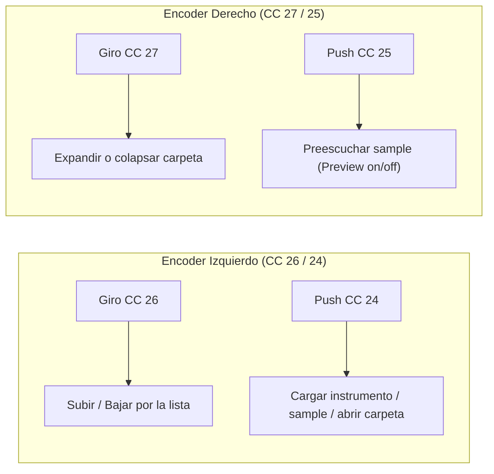
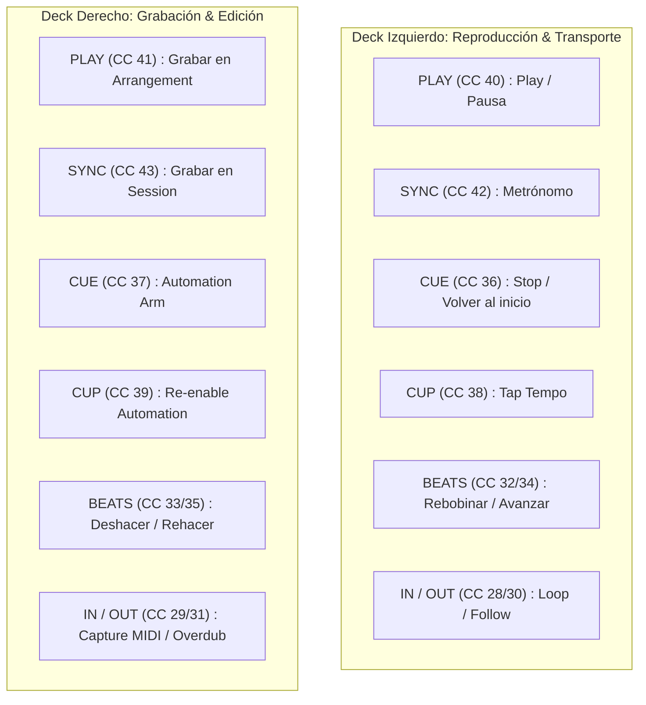
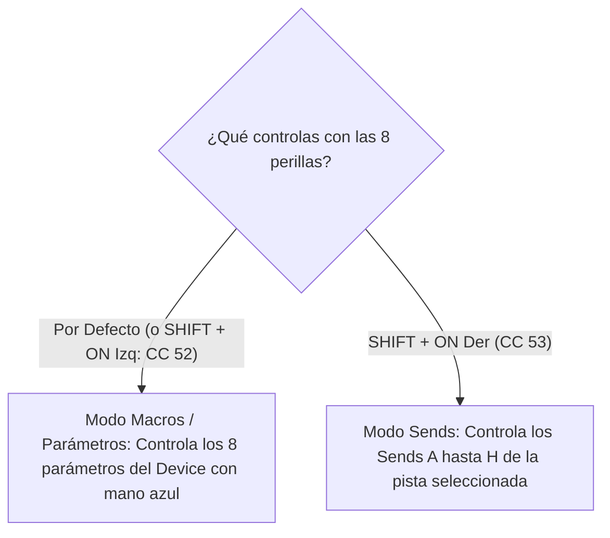

# 🎛️ Guía Visual de Mapeo — Traktor Kontrol X1 (Ableton Live 12)

Esta guía complementa la documentación principal con un **mapa visual intuitivo** de los controles, replicando exactamente la posición física del controlador **Native Instruments Traktor Kontrol X1 (MK1)** con el template **Basic** (Canal MIDI 2).

---

## 🖼️ Diagrama Gráfico del Controlador



---

## 📐 Esquema Visual en Texto (Distribución Física)

```text
======================================================================================
                         TRAKTOR KONTROL X1 — ABLETON LIVE 12
                      [ Template Basic | Canal MIDI 2 (CH 1) ]
======================================================================================

                     --- SECCIÓN SUPERIOR: DISPOSITIVO & PISTAS ---
  [ CC 8 ] (on)           (( CC 0 ))            (( CC 1 ))           [ CC 9 ] (on)
  Device ON/OFF           Parámetro 1           Parámetro 2          Armar Pista
  (SHIFT: Macros)        (SHIFT: Send A)       (SHIFT: Send B)       (SHIFT: Sends A-H)

  [ CC 10 ] (1)           (( CC 2 ))            (( CC 3 ))           [ CC 11 ] (1)
  ◀ Banco Prev            Parámetro 3           Parámetro 4          Banco Next ▶
                         (SHIFT: Send C)       (SHIFT: Send D)

  [ CC 12 ] (2)           (( CC 4 ))            (( CC 5 ))           [ CC 13 ] (2)
  ◀ Device Prev           Parámetro 5           Parámetro 6          ◀ Pista Prev

  [ CC 14 ] (3)           (( CC 6 ))            (( CC 7 ))           [ CC 15 ] (3)
  Device Next ▶           Parámetro 7           Parámetro 8          Pista Next ▶
                         (SHIFT: Send G)       (SHIFT: Send H)
--------------------------------------------------------------------------------------
                     --- NAVEGACIÓN ARRANGEMENT & SHIFT ---
     (( CC 16 ))                        [ SHIFT ]                        (( CC 17 ))
  Zoom Arrangement                    Modos Perillas                 Scroll Horizontal
  (Giro relativo)                    (Shift + ON Izq/Der)            (Giro relativo)
--------------------------------------------------------------------------------------
                     --- VISTAS DE ABLETON LIVE (BOTONES FX) ---
  [ CC 20 ] (FX 1)      [ CC 22 ] (FX 2)    |    [ CC 21 ] (FX 1)      [ CC 23 ] (FX 2)
  Toggle Browser        Session ⇄ Arr.      |    Vista Clip            Vista Devices
--------------------------------------------------------------------------------------
                     --- NAVEGACIÓN DEL BROWSER (AUTOFOCUS) ---
           (( CC 26 ))                                      (( CC 27 ))
     Giro: Subir / Bajar                [ HOTCUE ]            Giro: Abrir/Cerrar Carpeta
     Push (CC 24): Cargar / Abrir                             Push (CC 25): Preescuchar
--------------------------------------------------------------------------------------
                     --- SECCIÓN INFERIOR: TRANSPORTE & GRABACIÓN ---
     DECK IZQUIERDO (REPRODUCCIÓN)          |       DECK DERECHO (GRABACIÓN & EDICIÓN)
--------------------------------------------+-----------------------------------------
  [ CC 28 ] (IN)        [ CC 30 ] (OUT|4)   |    [ CC 29 ] (IN)        [ CC 31 ] (OUT|4)
  🔁 Loop On/Off        👁️ Follow Playhead   |    🎹 Capture MIDI       ➕ Arrangement Overdub

  [ CC 32 ] (◀ BEAT)    [ CC 34 ] (BEAT ▶)  |    [ CC 33 ] (◀ BEAT)    [ CC 35 ] (BEAT ▶)
  ⏪ Rebobinar (hold)   ⏩ Avanzar (hold)   |    ↩ Undo (Deshacer)     ↪ Redo (Rehacer)

  [ CC 36 ] (CUE|REL)   [ CC 38 ] (CUP|ABS) |    [ CC 37 ] (CUE|REL)   [ CC 39 ] (CUP|ABS)
  ⏹ Stop (x2=inicio)   🥁 Tap Tempo        |    🔴 Automation Arm     🔄 Re-enable Automation

  [ CC 40 ] (PLAY)      [ CC 42 ] (SYNC)    |    [ CC 41 ] (PLAY)      [ CC 43 ] (SYNC)
  ▶ Play / Pausa        ⏲ Metrónomo         |    ● Rec Arrangement     ● Rec Session
======================================================================================
```

---

## 🔄 Flujos de Trabajo (Diagramas Mermaid)

### 1. Navegación del Browser con los Encoders Inferiores
Cualquier movimiento sobre estos encoders **enfoca automáticamente el Browser de Live**:



---

### 2. Decks: Izquierda (Reproducción) vs Derecha (Grabación)



---

### 3. Modos de las 8 Perillas Superiores (Knob Modes)



---

## ⚡ Guía Rápida de Atajos y Trucos

* **Ir al compás 1.1.1 (Reinicio rápido):** Presiona `CUE` (Deck izquierdo, CC 36) **dos veces seguidas**.
* **Preescucha instantánea:** Gira el encoder inferior izquierdo (CC 26) para navegar por samples y presiona el encoder inferior derecho (CC 25) para preescuchar.
* **Cargar a pista seleccionada:** Presiona el encoder inferior izquierdo (CC 24) para insertar el preset o instrumento.
* **Captura lo que acabas de tocar:** Si improvisaste con un teclado y no estabas grabando, presiona `IN` en el deck derecho (CC 29) para ejecutar **Capture MIDI**.
* **Cambiar de vista rápidamente:** 
  * `FX 1` (izq) = Ocultar / mostrar Browser.
  * `FX 2` (izq) = Alternar entre vista Arrangement y Session.
  * `FX 1` (der) = Ver el Clip.
  * `FX 2` (der) = Ver la cadena de Efectos e Instrumentos (Devices).
* **Feedback de LEDs:** Los LEDs reflejan el estado real de Live (Play verde, Rec rojo, Metrónomo, Loop activo, pistas armadas, etc.).
